<p align="center">
  
</p>

<h1 align="center">Remio</h1>

<p align="center">
  <a href="README.md">English</a> ·
  <a href="README.zh-CN.md">简体中文</a> ·
  <a href="README.ja.md">日本語</a> ·
  <a href="README.ko.md">한국어</a>
</p>

<p align="center">
  <a href="https://github.com/getremio/remio/stargazers">
    
  </a>
  <a href="https://github.com/getremio/remio/releases">
    
  </a>
  <a href="https://discord.gg/jz8T2uahpH">
    
  </a>
</p>

<p align="center">Claude Code、Codex、Copilot、OpenCode、Pi のエージェントを、ひとつのインターフェースで。</p>

<p align="center">
  
</p>

<p align="center">
  
</p>

> [!NOTE]
> 私はひとりでメンテナンスしているため、GitHub Issues を毎日確認できるとは限りません。
> 急ぎの問題や作業がブロックされている場合は、[Discord](https://discord.gg/jz8T2uahpH) から連絡するのが一番早いです。

---

自分のマシンでエージェントを並列実行。スマートフォンからでもデスクからでも、開発を進めてリリースできます。

- **セルフホスト:** エージェントはあなたのマシン上で動作し、完全な開発環境を使用します。自分のツール・設定・スキルをそのまま活用できます。
- **マルチプロバイダー:** Claude Code、Codex、Copilot、OpenCode、Pi を同一のインターフェースで利用。タスクに合ったモデルを選べます。
- **音声コントロール:** 音声モードでタスクを口述したり問題を話し合ったりできます。ハンズフリーが必要なときに便利です。
- **クロスデバイス:** iOS、Android、デスクトップ、Web、CLI に対応。机で作業を始め、スマートフォンで確認し、ターミナルから自動化できます。
- **プライバシー優先:** Remio にはテレメトリー・トラッキング・強制ログインは一切ありません。

## スポンサー

<!-- Sponsors: one cell per sponsor in the order of packages/website/src/data/sponsors.ts, then "become a sponsor" cells up to three. -->
<table>
  <tr>
    <td align="center" width="33%"><a href="https://hoplite.sh/?utm_source=remio&utm_medium=readme&utm_campaign=sponsor"><picture><source media="(prefers-color-scheme: dark)" srcset="packages/website/public/sponsors/hoplite-on-dark.svg"></picture></a><br><sub>Cloud coding agents</sub></td>
    <td align="center" width="33%"><a href="https://remio.hoshizukimio.moe/sponsor">Remio のスポンサーになる</a></td>
    <td align="center" width="33%"><a href="https://remio.hoshizukimio.moe/sponsor">Remio のスポンサーになる</a></td>
  </tr>
</table>

## はじめかた

Remio はコーディングエージェントを管理するローカルサーバー（デーモン）を起動します。デスクトップアプリ・モバイルアプリ・Web アプリ・CLI などのクライアントがこのデーモンに接続します。

### 前提条件

エージェント CLI をひとつ以上インストールし、認証情報を設定しておく必要があります。

- [Claude Code](https://docs.anthropic.com/en/docs/claude-code)
- [Codex](https://github.com/openai/codex)
- [GitHub Copilot](https://github.com/features/copilot/cli/)
- [OpenCode](https://github.com/anomalyco/opencode)
- [Pi](https://pi.dev)

### デスクトップアプリ（推奨）

[remio.hoshizukimio.moe/download](https://remio.hoshizukimio.moe/download) または [GitHub のリリースページ](https://github.com/getremio/remio/releases)からダウンロードしてください。アプリを開くとデーモンが自動的に起動します。追加のインストールは不要です。

スマートフォンから接続するには、Settings 画面に表示される QR コードをスキャンしてください。

### CLI / ヘッドレス

CLI をインストールして Remio を起動します。

```bash
npm install -g @getremio/cli
remio
```

ターミナルに QR コードが表示されます。どのクライアントからでも接続できます。サーバーやリモートマシンでの利用に適しています。

詳しいセットアップと設定については以下を参照してください。

- [ドキュメント](https://remio.hoshizukimio.moe/docs)
- [設定リファレンス](https://remio.hoshizukimio.moe/docs/configuration)

## CLI

アプリでできることはすべてターミナルからも実行できます。

```bash
remio run --provider claude/opus-4.6 "implement user authentication"
remio run --provider codex/gpt-5.4 --worktree feature-x "implement feature X"

remio ls                           # 実行中のエージェントを一覧表示
remio attach abc123                # ライブ出力をストリーミング
remio send abc123 "also add tests" # 追加タスクを送信

# リモートデーモンで実行
remio --host workstation.local:7676 run "run the full test suite"
```

詳細は[完全な CLI リファレンス](https://remio.hoshizukimio.moe/docs/cli)を参照してください。

## スキル

スキルはエージェントに Remio を使って他のエージェントをオーケストレーションする方法を教えます。

```bash
npx skills add getremio/remio
```

どのエージェントとの会話でも使用できます。

- `/remio-handoff` — エージェント間で作業を引き継ぎます。私はこれを使って Claude で計画し、Codex に実装を引き継いでいます。
- `/remio-advisor` — 単一のエージェントをアドバイザーとして起動し、作業を委任せずにセカンドオピニオンを得ます。
- `/remio-committee` — 対照的な2つのエージェントで委員会を構成し、一歩引いた視点で根本原因を分析して計画を作成します。

## 開発

モノレポのパッケージ構成：

- `packages/server`: Remio デーモン（エージェントプロセスのオーケストレーション、WebSocket API、MCP サーバー）
- `packages/app`: Expo クライアント（iOS、Android、Web）
- `packages/cli`: デーモンおよびエージェントワークフロー向け `remio` CLI
- `packages/desktop`: Electron デスクトップアプリ
- `packages/relay`: リモート接続用リレーパッケージ
- `packages/website`: マーケティングサイトとドキュメント（`remio.hoshizukimio.moe`）

よく使うコマンド：

```bash
# すべてのローカル開発サービスを起動
npm run dev

# 個別のサービスを起動
npm run dev:server
npm run dev:app
npm run dev:desktop
npm run dev:website

# サーバースタックをビルド
npm run build:server

# リポジトリ全体のチェック
npm run typecheck
```

## Remio を支援する

Remio はコントリビューターによって開発・維持されているオープンソースプロジェクトです。企業として毎月[スポンサー](https://remio.hoshizukimio.moe/sponsor#spot)になっていただくと、ロゴをこの README の冒頭と、remio.hoshizukimio.moe のトップページおよびドキュメントに掲載します。

## 関連プロジェクト

- [getremio/remio-relay](https://github.com/getremio/remio-relay) — Elixir 製の公式分散リレー
- [remio-vscode](https://marketplace.visualstudio.com/items?itemName=hinnes.remio-vscode) — VS Code 拡張機能

## ライセンス

Apache-2.0
