<p align="center">
  
</p>

<h1 align="center">Remio</h1>

<p align="center">
  <a href="README.md">English</a> ·
  <a href="README.zh-CN.md">简体中文</a> ·
  <a href="README.ja.md">日本語</a> ·
  <a href="README.ko.md">한국어</a>
</p>

<p align="center">
  <a href="https://github.com/getremio/remio/stargazers">
    
  </a>
  <a href="https://github.com/getremio/remio/releases">
    
  </a>
  <a href="https://discord.gg/jz8T2uahpH">
    
  </a>
</p>

<p align="center">One interface for Claude Code, Codex, Copilot, OpenCode, Pi, Antigravity, and Muse Code agents.</p>

<p align="center">
  
</p>

<p align="center">
  
</p>

Remio is an open source agentic development environment for desktop, mobile, web, and CLI. Open the desktop app and work: agents, editor, terminals, diffs, pull requests, and a browser in one window. Run many agents at once, each in its own worktree, on one machine or several. The mobile app is the full app, native on iOS and Android.

- **Parallel agents:** Run many agents at once, each in its own worktree.
- **Built-in orchestration:** Agents in Remio can create worktrees, launch other agents, and talk to them, across providers.
- **Complete development workflow:** Edit files, review diffs, open pull requests, and run terminals, in split panes you arrange how you want.
- **Self-hosted:** Agents run on your machine with your full dev environment. Use your tools, your configs, and your skills.
- **Multi-provider:** Claude Code, Codex, Copilot, OpenCode, Pi, Antigravity, and Muse Code through the same interface. Pick the right model for each job.
- **Voice control:** Dictate tasks or talk through problems in voice mode. Hands-free when you need it.
- **Cross-device:** iOS, Android, desktop, web, and CLI. Start work at your desk, check in from your phone, script it from the terminal.
- **Privacy-first:** No telemetry, tracking, or forced login. Remote access uses an optional end-to-end encrypted relay.

[Run parallel tasks in Remio](https://remio.hoshizukimio.moe/docs/parallel-development): start agents in separate worktrees, review their diffs, run each app, and check it in the built-in browser.

## Sponsors

<!-- Sponsors: one cell per sponsor in the order of packages/website/src/data/sponsors.ts, then "become a sponsor" cells up to three. -->
<table>
  <tr>
    <td align="center" width="33%"><a href="https://hoplite.sh/?utm_source=remio&utm_medium=readme&utm_campaign=sponsor"><picture><source media="(prefers-color-scheme: dark)" srcset="packages/website/public/sponsors/hoplite-on-dark.svg"></picture></a><br><sub>Cloud coding agents</sub></td>
    <td align="center" width="33%"><a href="https://remio.hoshizukimio.moe/sponsor">Become a sponsor</a></td>
    <td align="center" width="33%"><a href="https://remio.hoshizukimio.moe/sponsor">Become a sponsor</a></td>
  </tr>
</table>

## Plugins

Plugins run on the daemon and show up in every client you connect, with the same UI on desktop, web,
iOS, and Android. Write a plugin once and it is on your phone.

- **UI:** screens, sidebar items, workspace panels, Command Center items, slash commands, composer pills, attachment sources, timeline items, themes.
- **Agent lifecycle:** change configuration, environment, and MCP servers, answer permissions, follow up when a turn ends.
- **Providers:** add a coding agent as a provider.

Install from the registry with `remio plugin add owner/slug`, or from Git or a local directory.

**[Browse plugins](https://remio.hoshizukimio.moe/plugins)** · **[Plugin docs](https://remio.hoshizukimio.moe/docs/plugins)**

Plugins run with access to your daemon machine and inside connected clients; install only code you trust.

## Getting Started

Remio runs a local server called the daemon that manages your coding agents. Clients like the desktop app, mobile app, web app, and CLI connect to it.

### Prerequisites

You need at least one agent CLI installed and configured with your credentials:

- [Claude Code](https://docs.anthropic.com/en/docs/claude-code)
- [Codex](https://github.com/openai/codex)
- [GitHub Copilot](https://github.com/features/copilot/cli/)
- [OpenCode](https://github.com/anomalyco/opencode)
- [Pi](https://pi.dev)
- [Antigravity](https://remio.hoshizukimio.moe/docs/supported-providers/antigravity)
- [Muse Code](https://remio.hoshizukimio.moe/docs/supported-providers/muse-code)
- [fx](https://remio.hoshizukimio.moe/docs/supported-providers/fx)
- [Hoplite](https://remio.hoshizukimio.moe/docs/supported-providers/hoplite)

Remio also runs Cursor, Gemini CLI, and many other agents. See [Supported providers](https://remio.hoshizukimio.moe/docs/supported-providers) for the full list and setup steps.

### Desktop app (recommended)

Download it from [remio.hoshizukimio.moe/download](https://remio.hoshizukimio.moe/download) or the [GitHub releases page](https://github.com/getremio/remio/releases). Open the app and the daemon starts automatically. Nothing else to install.

To connect from your phone, open **Settings → your host → Pair Device**.

### Server

For a server, a VM, or any machine without the desktop app. Install the CLI and start the daemon:

```bash
npm install -g @getremio/cli
remio
```

Remio starts, then asks whether to enable the end-to-end encrypted relay for device pairing. If you decline, connect directly over TCP, Tailscale, or another VPN. The desktop, mobile, and web apps connect to this daemon like any other host.

For full setup and configuration, see:

- [Docs](https://remio.hoshizukimio.moe/docs)
- [Connectivity guide](https://remio.hoshizukimio.moe/docs/connectivity)
- [Configuration reference](https://remio.hoshizukimio.moe/docs/configuration)

### Docker

Run the Remio daemon and self-hosted web UI in Docker:

```bash
docker run -d --name remio \
  -p 7676:7676 \
  -e REMIO_PASSWORD=change-me \
  -v "$PWD/remio-home:/home/remio" \
  -v "$PWD:/workspace" \
  ghcr.io/getremio/remio:latest
```

Open `http://localhost:7676` after it starts. Extend the base image with the agent CLIs you use, then provide credentials through environment variables or the persistent `/home/remio` volume. See the [Docker documentation](docs/docker.md) for full setup details.

## CLI

Everything you can do in the app, you can do from the terminal.

```bash
remio run --provider claude/opus-4.6 "implement user authentication"
remio run --provider codex/gpt-5.5 --worktree feature-x "implement feature X"

remio ls                           # list running agents
remio attach abc123                # stream live output
remio send abc123 "also add tests" # follow-up task

# run on a remote daemon; --cwd is a path on that host
remio run --host workstation.local:7676 --cwd /workspace "run the full test suite"
```

See the [full CLI reference](https://remio.hoshizukimio.moe/docs/cli) for more.

## TypeScript SDK

Build issue integrations, dashboards, and orchestration services with `@getremio/client`:

```ts
import { createRemioClient } from "@getremio/client";

const client = createRemioClient({ url: "ws://127.0.0.1:7676/ws" });
await client.connect();

const agent = await client.agents.create({
  config: { provider: "codex/gpt-5.5" },
  cwd: "/Users/me/dev/storefront",
  prompt: "Review the current diff and name the riskiest change.",
});

const result = await agent.waitForFinish();
console.log(result.lastMessage);

await client.close();
```

See the [SDK quickstart](https://remio.hoshizukimio.moe/docs/sdk/quickstart), [recipes](https://remio.hoshizukimio.moe/docs/sdk/recipes), and [API reference](https://remio.hoshizukimio.moe/docs/sdk/reference).

## Skills

Skills teach your agent to use Remio to orchestrate other agents.

```bash
npx skills add getremio/remio
```

Then use them in any agent conversation:

- `/remio-handoff` — hand off work between agents. I use this to plan with Claude and then handoff to Codex to implement.
- `/remio-advisor` — spin up a single agent as an advisor for a second opinion, without delegating the work itself.
- `/remio-committee` — form a committee of two contrasting agents to step back, do root cause analysis, and produce a plan.

## Development

Quick monorepo package map:

- `packages/server`: Remio daemon (agent process orchestration, WebSocket API, MCP server)
- `packages/app`: Expo client (iOS, Android, web)
- `packages/cli`: `remio` CLI for daemon and agent workflows
- `packages/desktop`: Electron desktop app
- `packages/relay`: Relay transport and encryption used by the daemon and clients
- `packages/website`: Marketing site and documentation (`remio.hoshizukimio.moe`)

Common commands:

```bash
# run all local dev services
npm run dev

# run individual surfaces
npm run dev:server
npm run dev:app
npm run dev:desktop
npm run dev:website

# build the server stack
npm run build:server

# repo-wide checks
npm run typecheck
```

## Support Remio

Remio is an open-source project built and maintained by its contributors. Companies can [sponsor Remio](https://remio.hoshizukimio.moe/sponsor#spot) monthly and have their logo shown at the top of this README and on the remio.hoshizukimio.moe homepage and docs.

## Related projects

- [getremio/remio-relay](https://github.com/getremio/remio-relay) — official distributed relay, written in Elixir
- [remio-vscode](https://marketplace.visualstudio.com/items?itemName=hinnes.remio-vscode) — VS Code extension

## License

Apache-2.0
